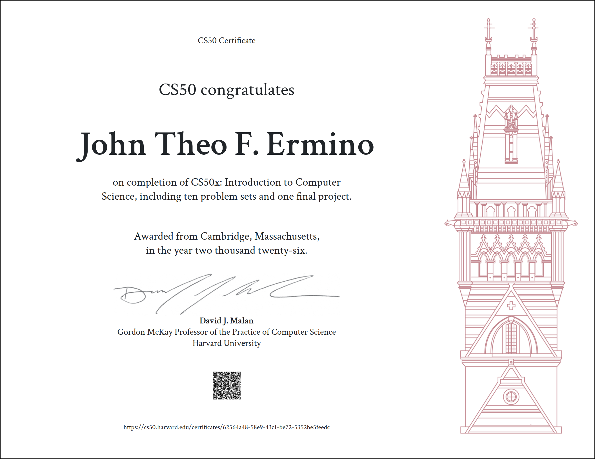

<h1 align="center">Hi, I'm Theo </h1>

  

  

    <b>🚀 Co-Founder of Potato Devs | Building a B2C Startup</b> 
    <b>🎓 Second-Year BS Computer Science Student</b> 
    <b>🤖 Currently Learning Machine Learning & AI</b>
  

## 📊 GitHub Stats

  
  

## 🎓 Certificates

<table>
  <tr>
    <td>
      
    </td>
    <td>
      <strong>CS50x: Introduction to Computer Science</strong> 
      Issued by Harvard University 
    </td>
  </tr>
</table>
