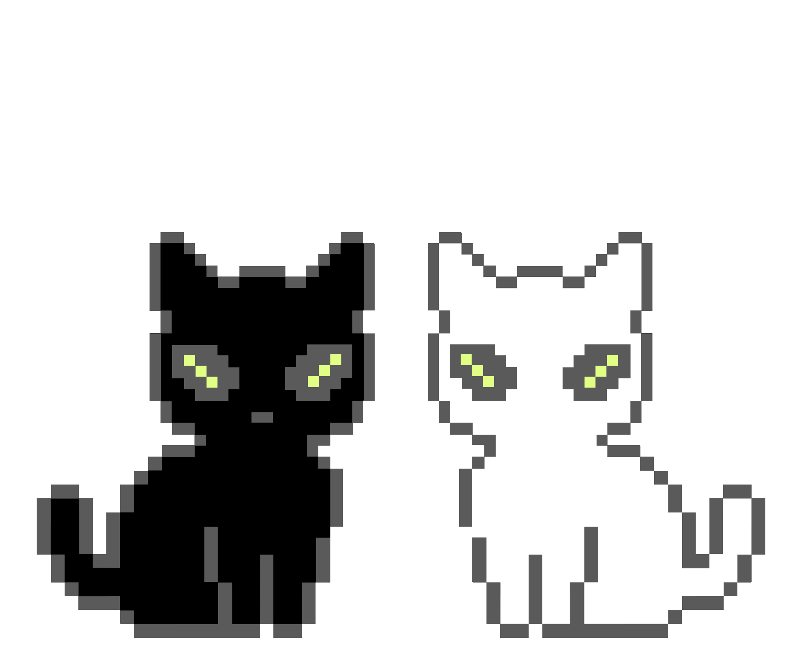

<h2 align="center">Hi, I'm Theo Ermino </h2>

  

  

    <b>🚀 Co-Founder of Potato Devs | Building a B2C TravelTech Startup</b> 
    <b>🎓 Second-Year BS Computer Science Student</b> 
    <b>🤖 Currently Learning Machine Learning & AI</b>
  

<b>📊 Github Stats:</b>

  
  

