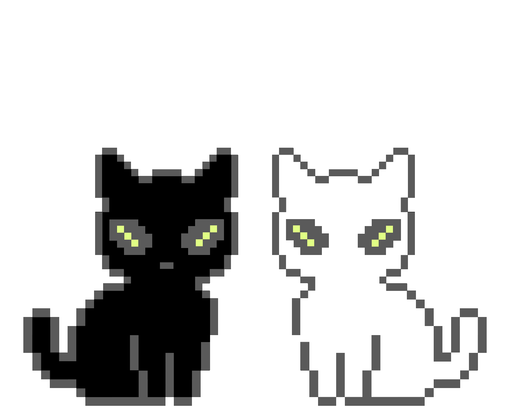

  

<h3>📊 GitHub Stats</h3>

<table width="100%" cellspacing="0" cellpadding="0">
  <tr>
    <td width="50%" align="left" valign="top">
      
    </td>
    <td width="50%" align="left" valign="top">
      
    </td>
  </tr>
</table>
